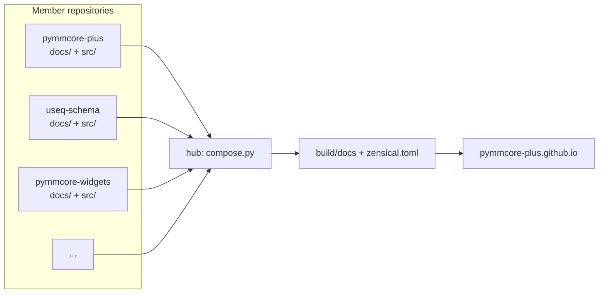

# How These Docs Work

This site is put together from the `docs/` folders (and docstrings) of several
repositories, so that all of the packages share one navigation and search, and can
link to each other.  It's built with [zensical](https://zensical.org) by
[pymmcore-plus/pymmcore-plus.github.io](https://github.com/pymmcore-plus/pymmcore-plus.github.io)
(the *hub*).



## Who owns what

**Each member repository** owns:

- `docs/`: its pages, written as they would be for a stand-alone site.  The folder is
  published at `/<repo-name>/`, so `pymmcore-plus/docs/guides/events.md` becomes
  `/pymmcore-plus/guides/events/`.
- `docs/**/.nav.yml`: [awesome-nav](https://lukasgeiter.github.io/mkdocs-awesome-nav/)
  files ordering the package's own section.
- `zensical.toml`: what is specific to the package: mkdocstrings `paths`,
  griffe `extensions`, and the `api-autonav` settings for its API reference.
- `docs/_gen.py` (optional): a script that generates content before the build,
  writing into git-ignored files (for example the
  [`CMMCorePlus` method table][pymmcore_plus.CMMCorePlus] or the widget
  screenshots).

**The hub** owns the theme, global settings, the landing page, *Getting
Started* (plus a few pages that don't belong to any one package, like
[Using your own microscope](../guide/own-microscope.md)), and the top-level
navigation (`docs/.nav.yml`), which places member pages into the site-wide
*User Guide*.

## Previewing locally

```sh
git clone https://github.com/pymmcore-plus/pymmcore-plus.github.io
cd pymmcore-plus.github.io
just serve          # clones members into .repos/ and serves http://localhost:8000
```

To edit a member's docs or code and see the result live, put a git worktree of
your own clone in `.repos/` instead (`tools/repos.py --worktrees ~/path/to/clones`,
or `git worktree add`).  Use `--only pymmcore-plus,useq-schema` for a faster
preview of just some packages, and `--no-gen` to skip the generation scripts.

`just check` builds with `--strict`, which fails on any warning (broken links,
unresolved cross-references, docstring problems).

## The API reference

API pages are generated from each member's `api-autonav` settings, with two
rules on top:

1. **Each object is documented once, at its highest-level public name.**
   `pymmcore_plus.Device` is documented on the `pymmcore_plus` page; the
   `pymmcore_plus.core` page lists it under *Re-exports* with a link.
   Cross-references to any public path (`[x][pymmcore_plus.core.Device]`) still
   resolve.
2. **Hand-written pages claim objects.**  If a page in `docs/` renders an object
   with a `::: identifier` block, that page is where the object is documented,
   and the generated pages link to it.  A hand-written page at a module's
   generated path (for example `docs/api/pymmcore_plus/metadata/index.md`)
   replaces the generated page.

## Writing tips

- Link to API objects with [autorefs](https://mkdocstrings.github.io/autorefs/):
  `` [`CMMCorePlus`][pymmcore_plus.CMMCorePlus] `` works from any page in any
  repository.
- Link to pages in other packages with relative paths
  (`../useq-schema/schema/axes.md`); they are checked when the site is built.
- Snippets (`--8<-- "examples/foo.py"`) are resolved relative to the member's
  repository root.
- If you want a heading to be linked from other repositories, give it an
  explicit, namespaced id: `## Installing {#widgets-install}`.

## How changes get published

- **Pull requests** to a member repository build the whole site with the PR's
  changes (failing only on warnings in that member's pages), and upload the
  result as an artifact you can download and browse.
- **Merges** to `main` trigger a rebuild and deploy of the full site.  The site
  is also rebuilt nightly.
